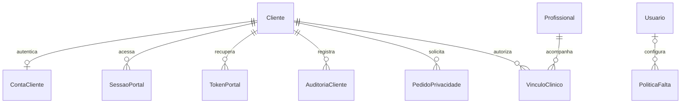

# BellaPelle v5 — continuação e estado da entrega

## Recuperação

A manutenção automática do ambiente removeu a pasta temporária da primeira implementação v5. A v4 salva foi recuperada e as alterações desta entrega foram reconstruídas. Os resultados em VALIDACAO-V5 referem-se exclusivamente à versão reconstruída. Os relatórios v4 e imagens antigas são históricos, não prova de validação atual.

## Implementações adicionais

- O site público atual é a raiz `/`; `/portal` redireciona para ela. O dashboard fica em `/admin`.
- Cadastro individual de clientes com CPF validado; login, cookie HttpOnly, CSRF, logout e recuperação/ativação com token temporário de uso único.
- O cadastro de cliente existente exige ativação pelo e-mail registrado. Não existe senha compartilhada nem acesso por identificação fornecida pelo navegador.
- Busca, catálogo, favoritos e agenda conectados ao MySQL. Reservas e remarcações usam o mesmo serviço transacional administrativo.
- Minha conta: contato, pacotes, parcelas e solicitações de privacidade. Pacotes adquiridos podem ser selecionados na reserva. Cobranças avulsas nascem pendentes; nenhuma cobrança PIX/cartão externa é simulada.
- Configuração da agenda publicada e vínculo clínico anterior à primeira avaliação.
- Política administrativa de faltas, com padrão sem débito, justificativa, captura da política aplicada no evento e proteção contra débito repetido.
- Histórico individual inclui faltas e atendimentos. Anamnese destaca fatores declarados sem diagnóstico automático.
- Permissões individuais editáveis. Calendário mensal corrigido para independer do fuso do navegador; nomes e filtros de recursos adicionados.
- Filtros de relatórios aplicáveis, impressão para PDF, gráfico de procedimentos e indicadores semanais, vencimentos, comissões e taxa de faltas.
- Worker SMTP com fila, expiração, tentativas e remoção do conteúdo após envio.
- ESLint, novas verificações HTTP e E2E em Chromium com MySQL real.

## Modelo e decisões

Migration 005 adiciona ContaCliente, SessaoPortal, TokenPortal, AuditoriaCliente, VinculoClinico, PoliticaFalta e PedidoPrivacidade; complementa EmailOutbox e EventoAgenda. As migrations 001–004 permanecem inalteradas. Não há exclusão automática de prontuário ou histórico financeiro por pedido do cliente: a clínica analisa retenção e responde à solicitação.

Uma falta só consome se a política foi expressamente ativada; não gera comissão nem estoque. Cancelamento não consome. A conclusão transacional mantém consumo, movimentação e comissão únicos. Cancelamento de reserva não é reembolso: o financeiro concilia e executa estorno interno auditável.

A stack original foi preservada: Next App Router + React + TypeScript + Tailwind, Route Handlers REST, mysql2, Zod e MySQL 8.4. Não foi adicionado um segundo servidor Express ou um ORM para reescrever operações já funcionais.

## DER complementar

O restante do modelo e as correções originais de PK/FK, saldos, lotes e histórico estão em MODELO-DADOS.md. O DDL é a especificação física completa.
