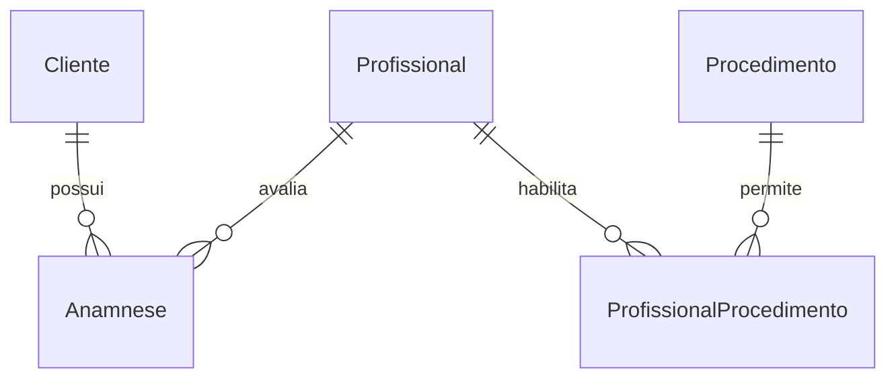
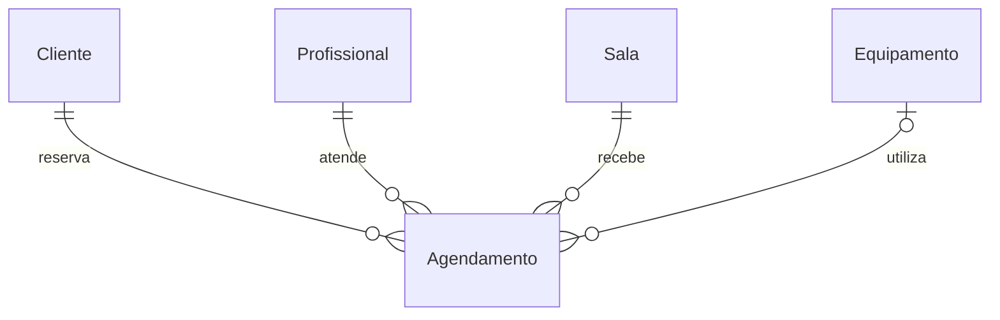
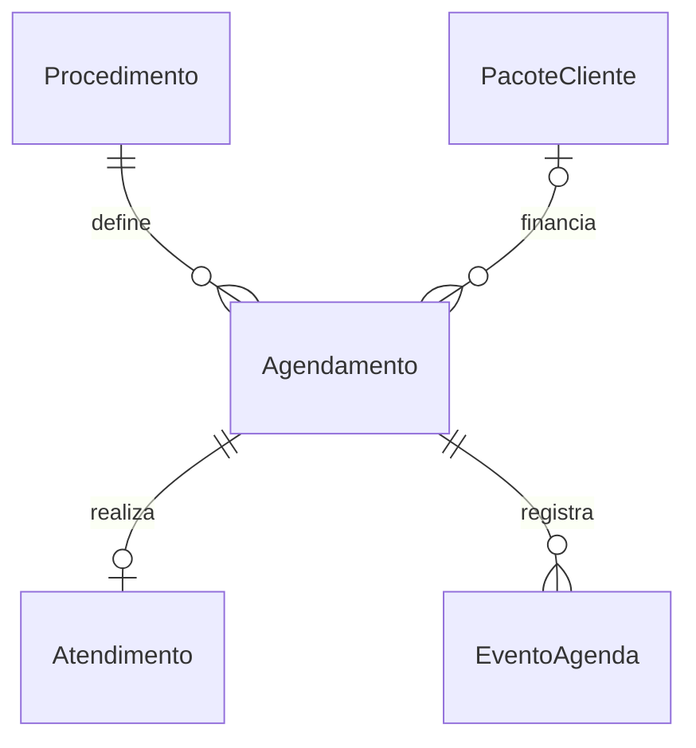
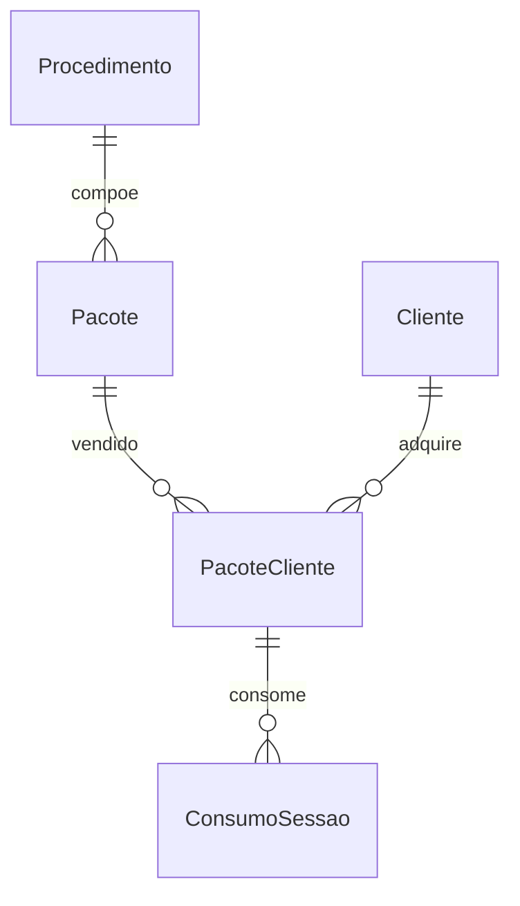
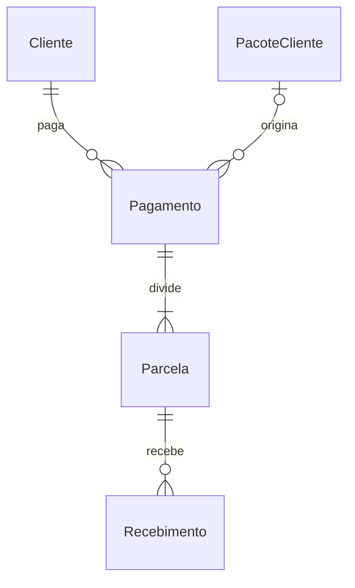
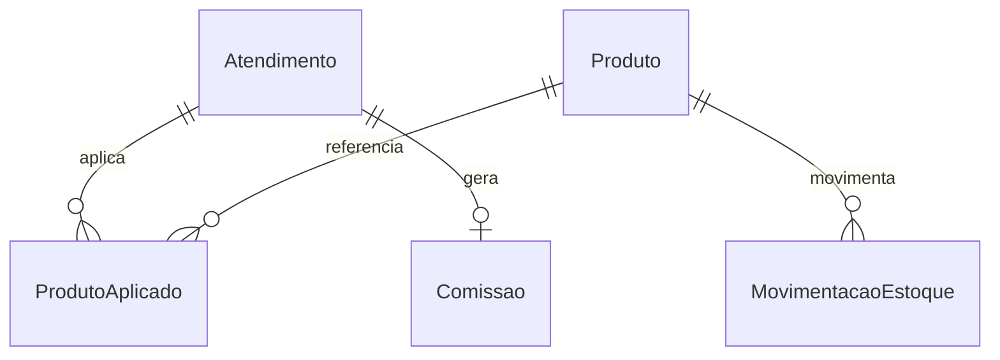
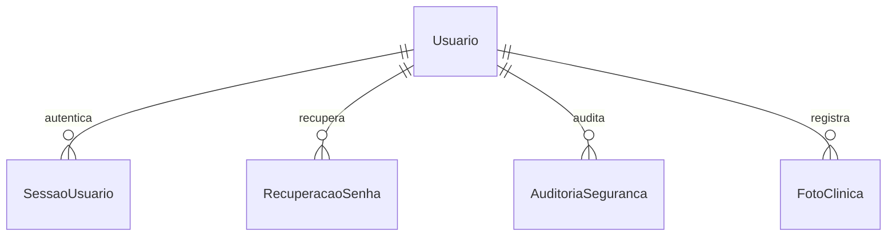

# Modelo lógico e físico

DDL físico canônico: `database/001-base.sql`, `002-api.sql`, `003-clinic.sql`, `004-security.sql`. Todos os identificadores principais são inteiros unsigned, com FKs e índices de relacionamento. Valores financeiros são DECIMAL; quantidades usam três casas. Todas as tabelas de negócio permanecem em InnoDB.

## Divergências do DER original

| Ponto original | Modelo implementado | Justificativa |
|---|---|---|
| Agendamento/Pacote/MovimentacaoEstoque e Parcela com identificador marcado FK | Identificador próprio como PK autoincremental | Correção de notação sem mudar o conceito |
| ProfissionalProcedimento sem unicidade explícita do par | UNIQUE profissional/procedimento | Evitar habilitação/comissão duplicada |
| ProdutoAplicado sem FK para estoque e sem quantidade | FK id_produto, quantidade e snapshot de nome/marca/lote/validade | Baixa consistente e histórico do item utilizado |
| Produto contém dados do lote | Cada registro representa um produto/lote, preservando o modelo v3 | Uma marca/item pode ter lotes distintos; futura separação de SKU/lote não é necessária para integridade atual |
| Saldo de sessões duplicado e editável | Contratadas/usadas e restantes geradas; ConsumoSessao único por agendamento | Evitar divergência de saldo e repetição de consumo |
| Pagamento ligado somente ao pacote | Destino exclusivo pacote ou agendamento avulso, com FKs compostas de cliente | Suportar sessão avulsa sem cobrar cliente errado |
| Parcela com status, mas sem recebimento parcial | valor_recebido e ledger Recebimento (recebimento/estorno) | Saldo parcial, rastreabilidade e estornos |
| Atendimento sem estado de execução | iniciado/concluido e vínculo único com agendamento | Finalização idempotente |
| Ausência de histórico de agenda | EventoAgenda | Motivo e autoria de falta/cancelamento/remarcação |
| Percentual atual usado para relatórios antigos | Comissao registra base/percentual/valor na conclusão | Preservar histórico de apuração |
| Ausência de autenticação/auditoria | Usuario, SessaoUsuario, RecuperacaoSenha, LimiteAcesso, Auditoria e AuditoriaSeguranca | Controle de acesso e rastreabilidade |
| Disponibilidade não modelada | Disponibilidade e Bloqueio | Jornada, manutenção e indisponibilidade |
| Fotos sem persistência privada | FotoClinica com consentimento e arquivo protegido | Acesso clínico e registro de autorização |
| Preço mutável sem trilha | HistoricoPreco e valores contratados/congelados | Preservar valores antigos |

## DER atualizado — cadastros e avaliação

## DER atualizado — agenda

## DER atualizado — pacotes e financeiro

## DER atualizado — estoque e comissão

## DER atualizado — segurança

Relações adicionais no DDL: FotoClinica → Atendimento; Comissao → Profissional; ConsumoSessao → Agendamento; MovimentacaoEstoque → Atendimento opcional; Disponibilidade/Bloqueio → recursos; Profissional → Usuario opcional. O diagrama está dividido para leitura; o DDL reúne todas as constraints reais. Favorito/Avaliacao/SessaoCliente/AgendaConfiguracao do portal legado foram preservados.

## Invariantes

O lock da linha 1 de ControleAgenda serializa as operações de negócio críticas. Agendamento valida intervalos semiabertos (`inicio < fim_existente` e `fim > inicio_existente`), permitindo horários adjacentes. A mesma transação verifica saldo de pacote e reserva; conclusão verifica validade novamente. Atualização condicional de estoque exige quantidade suficiente. UNIQUE em Atendimento/ConsumoSessao/Comissao impede repetição de lançamento.

Campos de saúde ficam fora de endpoints genéricos de clientes. Consultas clínicas são auditadas; profissionais são limitados pelo vínculo com a própria agenda. IDs em requests passam por validação numérica, e nomes de colunas/tabelas vêm de um catálogo interno, sem interpolação livre de entrada do usuário.
